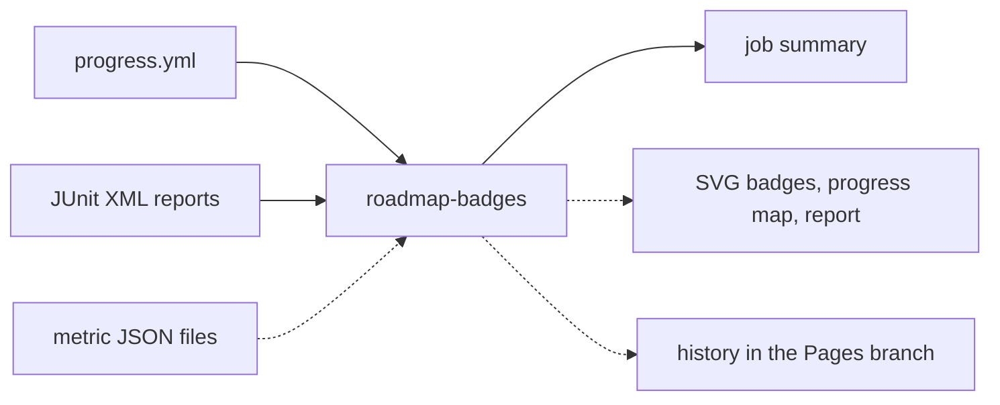

# Roadmap Badges

A GitHub Action that **computes** how far a project has got, from a catalog of what it sets out to
do and the results of its own tests, and publishes the result as badges, a progress map and a
history.

[](https://github.com/zxxdev/roadmap-badges/actions/workflows/ci.yml)
[](LICENSE)

> **Status: early development.** Today the action reads the catalog and the JUnit test reports,
> decides which items are done and reports the progress of each area in the job summary. Drawing
> the badges comes next (see [Roadmap](#limitations-and-roadmap)). Images of the badges and the
> report will be added when the action draws them.

## Contents

- [Why it exists](#why-it-exists)
- [What it does](#what-it-does)
- [How it differs from existing actions](#how-it-differs-from-existing-actions)
- [Usage](#usage)
- [The catalog: progress.yml](#the-catalog-progressyml)
- [Linking tests to items](#linking-tests-to-items)
- [How it works](#how-it-works)
- [Decisions](#decisions)
- [Quality](#quality)
- [Development](#development)
- [Security](#security)
- [Limitations and roadmap](#limitations-and-roadmap)
- [License](#license)

## Why it exists

A README that says "80% done" usually means someone typed 80. This action makes the number
checkable: the project lists what it sets out to do in a `progress.yml` file, each item is linked
to the tests that prove it, and the percentage is what CI can actually verify. Missing or skipped
tests count as not done, dropped items stay visible with their reason, and the history shows when
the list grew.

## What it does

- Reads `progress.yml`: the items a project sets out to do, grouped in areas.
- Decides each item from evidence: **JUnit XML** test reports (written by Vitest, Pester, pytest,
  Playwright, Maven and most other tools) or a **manual** `done` flag, used as little as
  possible. An item proved by tests is done only when its tests exist and all of them pass.
- Reports the progress of each area in the job summary, with the reason for every item that is
  not done.

Planned (see [Roadmap](#limitations-and-roadmap)): **metric JSON** files with a target, **SVG
badges** per area and overall, a **progress map**, an HTML report that links each item to its
tests, and a **history** in the Pages branch.

## How it differs from existing actions

Before writing it, these were the closest existing actions (checked in November 2026):

| Action                                                                                                                                                                                                                                                  | What it does                                                                       | Difference                                                              |
| ------------------------------------------------------------------------------------------------------------------------------------------------------------------------------------------------------------------------------------------------------- | ---------------------------------------------------------------------------------- | ----------------------------------------------------------------------- |
| [gaelgirodon/ci-badges-action](https://github.com/gaelgirodon/ci-badges-action)                                                                                                                                                                         | Badges for test counts and coverage from JUnit, Cobertura, JaCoCo and LCOV reports | Counts tests; no catalog of features, no progress percentage or history |
| [markpatterson27/points-bar](https://github.com/markpatterson27/points-bar)                                                                                                                                                                             | Draws an SVG points bar from a value like `25/50`                                  | Draws a number you give it; does not compute it                         |
| [mikepenz/action-junit-report](https://github.com/mikepenz/action-junit-report), [dorny/test-reporter](https://github.com/dorny/test-reporter), [EnricoMi/publish-unit-test-result-action](https://github.com/EnricoMi/publish-unit-test-result-action) | Turn test reports into check runs, annotations and summaries                       | Report test results; they do not map tests to features                  |
| [shields.io](https://shields.io/) dynamic badges                                                                                                                                                                                                        | Draw a badge from a value in a JSON file or endpoint                               | Draw any number; something else has to compute it                       |

None of them turns a declared list of features plus test evidence into a progress figure. That
calculation, and keeping it honest, is what this action adds.

## Usage

The action is not released yet. To try the current version, run it after your tests, with the
JUnit reports they write:

```yaml
- uses: actions/checkout@v7
- run: npx vitest run --reporter=default --reporter=junit --outputFile.junit=reports/junit.xml
- uses: zxxdev/roadmap-badges@main # use a tag once one is released
  id: progress
  if: ${{ !cancelled() }} # also when some tests failed: they count as not done
  with:
    reports: reports/*.xml
- run: echo "${{ steps.progress.outputs.done }} of ${{ steps.progress.outputs.items }} items done"
```

| Input     | Default        | Description                                                                                                                           |
| --------- | -------------- | ------------------------------------------------------------------------------------------------------------------------------------- |
| `catalog` | `progress.yml` | Path to the catalog, relative to the repository root. The step fails if it is missing or wrong.                                       |
| `reports` | (none)         | JUnit XML reports: glob patterns, one per line. Each must match at least one file. Needed when the catalog has items proved by tests. |
| `strict`  | `false`        | When `true`, a tag in a test name that matches no item fails the step instead of warning.                                             |

| Output    | Description                                                                            |
| --------- | -------------------------------------------------------------------------------------- |
| `areas`   | Number of areas in the catalog.                                                        |
| `items`   | Number of items that count towards the total (dropped items do not).                   |
| `dropped` | Number of dropped items.                                                               |
| `done`    | Number of items done.                                                                  |
| `percent` | Percentage done, rounded down so that 100 means everything. Empty if nothing to count. |

The step fails, naming the file, when a pattern matches nothing (a silent 0 % from a mistyped
path would be worse), when a report is empty, broken or not JUnit, or when the catalog has items
proved by tests and no reports were given.

The job summary has a table of areas and lists every item that is not done with its reason. This
is the summary for the example reports in [tests/fixtures/junit](tests/fixtures/junit), written by
Vitest, Pester and pytest, which CI checks on every change:

> **junit-examples**: 6 of 15 items done (40%). Catalog `tests/fixtures/junit/catalog.yml`, 3
> JUnit reports with 15 tests.
>
> | Area   | Done | Items | Progress | Dropped |
> | ------ | ---: | ----: | -------: | ------: |
> | Vitest |    2 |     5 |      40% |       0 |
> | Pester |    2 |     4 |      50% |       0 |
> | pytest |    2 |     6 |      33% |       1 |

Below the table, a folded list gives the 9 items not done with their reasons, for example:

> | Item                                     | Area   | Why                                                    |
> | ---------------------------------------- | ------ | ------------------------------------------------------ |
> | `vitest.list` List users                 | Vitest | failed: "users &gt; lists users in pages @vitest.list" |
> | `vitest.import` Import users             | Vitest | no test is tagged @vitest.import                       |
> | `pytest.removed` A test that was deleted | pytest | not in any report: "test_removed"                      |

## The catalog: progress.yml

The catalog lists what the project sets out to do, in areas. Each item says how it is proved:

```yaml
# yaml-language-server: $schema=https://raw.githubusercontent.com/zxxdev/roadmap-badges/main/schema/progress.schema.json
project: my-service
areas:
  - id: api
    title: API
    items:
      - id: api.get-user
        title: Get a user by id
        evidence: junit # done when the tests tagged @api.get-user pass
      - id: api.export
        title: Export users to CSV
        evidence: junit
        tests: # for tests that cannot carry the tag in their name
          - name: exports every user
            classname: tests/export.test.ts
        dropped: Replaced by the reports area # leaves the total, stays visible
  - id: docs
    title: Documentation
    items:
      - id: docs.runbook
        title: Runbook reviewed by the on-call team
        evidence: manual # only for what no test can check
        done: false
```

| Field                      | Rule                                                                                                               |
| -------------------------- | ------------------------------------------------------------------------------------------------------------------ |
| `project`                  | The project's name. Required.                                                                                      |
| `areas[].id`, `items[].id` | Lowercase letters and digits joined by `.` or `-`. Area ids are unique; item ids are unique across the whole file. |
| `title`                    | Required, not empty.                                                                                               |
| `evidence`                 | `junit` (proved by tests) or `manual` (decided by `done`). Required: there is no default.                          |
| `tests`                    | Optional, `junit` items only: tests chosen by `name` and, if needed, `classname`.                                  |
| `done`                     | Required for `manual` items, and only for them: `true` or `false`.                                                 |
| `dropped`                  | Optional: why the item was dropped. It leaves the total but stays in the file and the report.                      |

Unknown fields are errors, so a misspelt field cannot be ignored silently. When the catalog is
not valid, the step fails and lists every problem at once, with its line, column and field, in
the log and in the job summary. In a pull request they also show as annotations on their lines
(GitHub shows up to 10 per step):

```text
Error: tests/fixtures/catalogs/invalid.yml:10:19 areas[0].items[0].evidence: must be "junit" or "manual", not "junti"
Error: tests/fixtures/catalogs/invalid.yml:11:13 areas[0].items[1].id: must be lowercase letters and digits, joined by single "." or "-" (for example "api.get-user")
Error: tests/fixtures/catalogs/invalid.yml:14:9 areas[0].items[2].title: missing required field
Error: tests/fixtures/catalogs/invalid.yml:16:15 areas[0].items[2].done: must be true or false, not "yes"
Error: roadmap-badges: the catalog at tests/fixtures/catalogs/invalid.yml has 4 problems.
```

That is the output for [tests/fixtures/catalogs/invalid.yml](tests/fixtures/catalogs/invalid.yml),
an example CI runs the action on in every change. The file is read as YAML 1.2, so `yes` is text,
not `true`.

**Editor support.** [`schema/progress.schema.json`](schema/progress.schema.json) is a JSON Schema
generated from the same rules the action applies. With the first line of the example above, VS
Code (with the YAML extension) and JetBrains IDEs autocomplete fields and flag mistakes while you
type. The action still has the last word: the JSON Schema cannot check that ids are unique.

This repository measures itself with its own [progress.yml](progress.yml): CI runs the action
on it with the Vitest report of its own tests.

## Linking tests to items

An item with `evidence: junit` is **done only when at least one test is linked to it and all its
linked tests pass**. Otherwise it is not done, with the most serious reason: a test failed or
ended in an error, a test named in `tests` is in no report, a test was skipped, or no test is
linked at all. Deleting, skipping or mistyping a test can only lower the number
([ADR 0003](docs/adr/0003-an-item-is-done-only-when-its-tests-pass.md)).

There are two ways to link a test to an item, and an item can use both:

- **A tag in the test's name**: `@` followed by the item's id, such as
  `it("returns 404 for an unknown user @api.get-user")`. The id is compared whole, so a test
  tagged `@api.get-all` does not link to `api.get`. A tag that matches no item is usually a
  typo: it is a warning, or an error with `strict: true`.
- **A selector in the catalog** (`tests:`), with the test's `name` exactly as the report has it
  and, if two tests share it, its `classname`. For tests that cannot be renamed.

When the same test appears more than once (two reports, or a retry), a failure in any run
counts; otherwise a pass counts over a skip, so a Windows-only test that is skipped on Linux
and passes on Windows proves its item. Percentages are rounded down, so 100 % means everything
is done, and an area with nothing to count has no percentage.

Each tool writes JUnit in its own way. What to know about the common ones, from the
[example reports](tests/fixtures/junit) that [generate.sh](tests/fixtures/junit/generate.sh)
writes with the real tools:

| Tool   | How to get JUnit XML                                                                           | Test name in the report                                                                                                                                                                                     |
| ------ | ---------------------------------------------------------------------------------------------- | ----------------------------------------------------------------------------------------------------------------------------------------------------------------------------------------------------------- |
| Vitest | `--reporter=junit --outputFile.junit=reports/junit.xml`                                        | `describe > test`, so a tag anywhere in the test's title works                                                                                                                                              |
| Pester | `TestResult.Enabled = $true` and `TestResult.OutputFormat = 'JUnitXml'` (the default is NUnit) | `Describe.It`: put the tag in the `It` text. At the end of a `Describe` it would run into the dot before the test's name and become part of the id                                                          |
| pytest | `--junitxml=reports/pytest.xml`                                                                | the function name, which cannot hold `@`: use a selector, or the id of a single `parametrize`, such as `ids=["@api.get"]`. Stacked `parametrize` ids are joined with `-`, which would become part of the id |

## How it works



Solid lines exist today; dotted ones are planned. The code is in four parts:

- `src/catalog/`: the catalog's rules, written once with [zod](https://zod.dev/)
  (`schema.ts`), and the reader (`parse.ts`), which parses the YAML with
  [`yaml`](https://eemeli.org/yaml/). zod says which field is wrong; the YAML document, which
  keeps each node's position, says on which line and column.
- `src/evidence/junit.ts`: turns any tool's JUnit XML into a flat list of test cases. It walks
  the whole tree (suites can be nested), counts the `<testcase>` elements instead of trusting the
  totals some tools write, and parses with [sax](https://github.com/isaacs/sax-js) in strict
  mode ([ADR 0004](docs/adr/0004-read-junit-reports-with-sax.md)).
- `src/evidence/evaluate.ts`: links tests to items and decides which items are done. It is a
  pure function of the catalog and the test cases, with no files or clock, so the rule is where
  most of the tests are.
- `src/main.ts`: the steps of a run, which talk to the runner only through a small `Runner`
  interface, so tests pass a fake one.
- `src/index.ts`: connects that interface to the real runner with
  [`@actions/core`](https://github.com/actions/toolkit/tree/main/packages/core).

Rollup bundles them, with their dependencies, into `dist/index.js`, which is what GitHub runs.

## Decisions

- [0001](docs/adr/0001-bundle-the-action-with-rollup.md): TypeScript 6.0 bundled by Rollup into a
  committed `dist/index.js`, on Node 24, with CI checking that the bundle matches the source.
- [0002](docs/adr/0002-validate-the-catalog-with-zod-and-yaml.md): the catalog's rules in zod,
  positions from `yaml`, a generated JSON Schema; explicit evidence, unique ids, unknown fields
  are errors, and a missing or invalid catalog fails the step.
- [0003](docs/adr/0003-an-item-is-done-only-when-its-tests-pass.md): an item is done only when
  its linked tests exist and pass; a missing, skipped or failed test means not done.
- [0004](docs/adr/0004-read-junit-reports-with-sax.md): JUnit reports are parsed with sax in
  strict mode, which never expands DOCTYPE entities or loads external ones.

## Quality

On every pull request and push to `main`, CI:

- checks formatting (Prettier), lints with type-aware rules (typescript-eslint) and type checks;
- runs the unit tests (Vitest), including one that fails if `schema/progress.schema.json` no
  longer matches the rules in the source;
- rebuilds `dist/index.js` and `dist/licenses.txt` and fails if they differ from the committed
  ones;
- runs the action itself from the checkout: on this repository's catalog with the report of its
  own tests, in strict mode; on the example reports from Vitest, Pester and pytest, checking the
  result worked out by hand; and on an invalid catalog, a missing one, a pattern with no reports
  and a misspelt tag in strict mode, checking that each fails;
- audits dependencies, and CodeQL analyses the source and the workflows.

The only badge above is CI, because it is the only one that exists. A progress badge for this
repository will come from the action itself once it can draw one.

## Development

Requirements: Node.js 24 or later and pnpm 12.

```sh
pnpm install --frozen-lockfile
pnpm all      # format check, lint, type check, tests and bundle
```

```text
action.yml                    inputs, outputs and the file GitHub runs
progress.yml                  this repository's own catalog
src/catalog/                  catalog rules (zod) and reader (yaml)
src/evidence/                 JUnit reader (sax) and the rule that decides what is done
src/main.ts, src/index.ts     the run, and its connection to the runner
tests/                        Vitest tests
tests/fixtures/junit/         example reports from real tools, their sources and generate.sh
schema/progress.schema.json   generated JSON Schema (committed, do not edit)
dist/index.js                 generated bundle (committed, do not edit)
dist/licenses.txt             licences of the bundled packages (generated with the bundle)
docs/adr/                     decision records
```

The example reports are regenerated with `tests/fixtures/junit/generate.sh`, which needs
PowerShell 7 with Pester and Python 3 with pytest; CI uses the committed files.

After changing `src/catalog/schema.ts`, run `pnpm test -u` to regenerate the JSON Schema.

More in [CONTRIBUTING.md](CONTRIBUTING.md).

## Security

The action runs inside other people's workflows, so it asks for no permissions of its own and has
four runtime dependencies: `@actions/core`, `zod`, `yaml` and `sax`, the last three with no
dependencies of their own. Their licences are in `dist/licenses.txt`, next to the bundle.
Dependencies wait 7 days after release before pnpm installs them, install scripts are blocked,
and third-party actions in this repository's workflows are pinned by commit SHA.

The catalog is read as data only: YAML tags cannot run code, repeated keys are rejected, and alias
expansion is capped so a small file cannot blow up in memory. Test reports are untrusted XML:
entities declared in a DOCTYPE are never expanded ("billion laughs") and external entities are
never loaded (XXE); both are refused with an error, and tests check it. Text from the catalog and
from test names is escaped before it goes into the job summary. To report a vulnerability, see
[SECURITY.md](SECURITY.md).

## Limitations and roadmap

Today it computes the progress and shows it in the job summary; it does not draw badges yet.
Known limits:

- Reports are read as UTF-8. The example reports cover Vitest, Pester and pytest; examples from
  Playwright and Maven Surefire come with version 1.0. Surefire's retries (`flakyFailure`) are
  read, but only from a hand-written case so far.
- A test that passes without checking anything still proves its item. No rule based on test
  results can see that; the catalog and the tests are in the repository for anyone to read.
- Tags are lowercase, like ids. A tag typed with capitals (`@Api.get`) is not read as a tag at
  all, so `strict` does not catch it; its item shows as having no test.

Planned, in order:

1. ~~The catalog: schema for `progress.yml`, clear errors with line and field, a JSON Schema for
   editors.~~ Done.
2. ~~Evidence: JUnit XML reports and the link between items and tests.~~ Done.
3. Badges: SVG with accessible text.
4. Progress map and HTML report.
5. History in the Pages branch.
6. Version 1.0: metric files, a catalog built from an OpenAPI specification, more examples and
   the Marketplace listing.

## License

[MIT](LICENSE)
