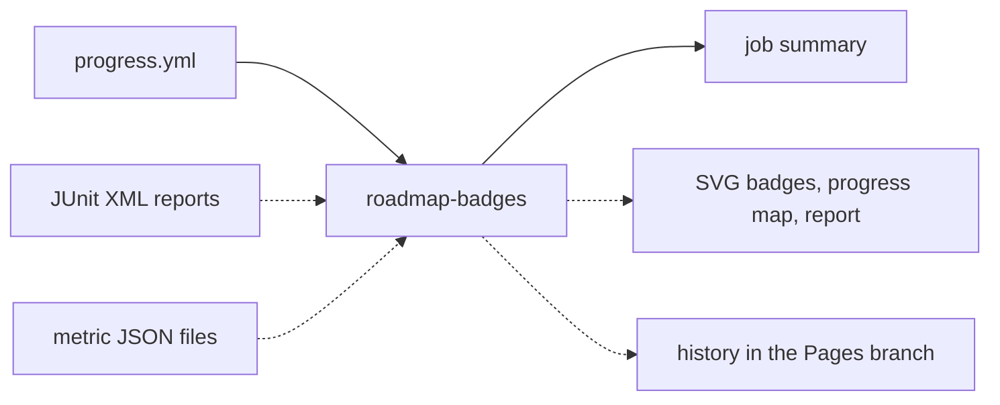

# Roadmap Badges

A GitHub Action that **computes** how far a project has got, from a catalog of what it sets out to
do and the results of its own tests, and publishes the result as badges, a progress map and a
history.

[](https://github.com/zxxdev/roadmap-badges/actions/workflows/ci.yml)
[](LICENSE)

> **Status: early development.** Today the action only finds the catalog file and reports it.
> Reading the catalog, the test reports and drawing the badges come in the next versions (see
> [Roadmap](#limitations-and-roadmap)). Images of the badges and the report will be added when the
> action draws them.

## Contents

- [Why it exists](#why-it-exists)
- [What it will do](#what-it-will-do)
- [How it differs from existing actions](#how-it-differs-from-existing-actions)
- [Usage](#usage)
- [How it works](#how-it-works)
- [Decisions](#decisions)
- [Quality](#quality)
- [Development](#development)
- [Security](#security)
- [Limitations and roadmap](#limitations-and-roadmap)
- [License](#license)

## Why it exists

A README that says "80% done" usually means someone typed 80. This action makes the number
checkable: the project lists what it sets out to do in a `progress.yml` file, each item is linked
to the tests that prove it, and the percentage is what CI can actually verify. Missing or skipped
tests count as not done, dropped items stay visible with their reason, and the history shows when
the list grew.

## What it will do

- Read `progress.yml`: the items a project sets out to do, grouped in areas.
- Decide each item from evidence: **JUnit XML** test reports (written by Vitest, Pester, pytest,
  Playwright, Maven and most other tools), **metric JSON** files with a target, or a **manual**
  `done` flag, used as little as possible.
- Publish **SVG badges** per area and overall, a **progress map** and an HTML report that links each
  item to its tests.
- Keep a **history** in the Pages branch, so the progress over time is visible.

## How it differs from existing actions

Before writing it, these were the closest existing actions (checked in November 2026):

| Action | What it does | Difference |
| --- | --- | --- |
| [gaelgirodon/ci-badges-action](https://github.com/gaelgirodon/ci-badges-action) | Badges for test counts and coverage from JUnit, Cobertura, JaCoCo and LCOV reports | Counts tests; no catalog of features, no progress percentage or history |
| [markpatterson27/points-bar](https://github.com/markpatterson27/points-bar) | Draws an SVG points bar from a value like `25/50` | Draws a number you give it; does not compute it |
| [mikepenz/action-junit-report](https://github.com/mikepenz/action-junit-report), [dorny/test-reporter](https://github.com/dorny/test-reporter), [EnricoMi/publish-unit-test-result-action](https://github.com/EnricoMi/publish-unit-test-result-action) | Turn test reports into check runs, annotations and summaries | Report test results; they do not map tests to features |
| [shields.io](https://shields.io/) dynamic badges | Draw a badge from a value in a JSON file or endpoint | Draw any number; something else has to compute it |

None of them turns a declared list of features plus test evidence into a progress figure. That
calculation, and keeping it honest, is what this action adds.

## Usage

The action is not released yet. To try the current version from a workflow:

```yaml
- uses: actions/checkout@v7
- uses: zxxdev/roadmap-badges@main # use a tag once one is released
  id: progress
  with:
    catalog: progress.yml # the default
- run: echo "Catalog found: ${{ steps.progress.outputs.catalog-found }}"
```

| Input | Default | Description |
| --- | --- | --- |
| `catalog` | `progress.yml` | Path to the catalog, relative to the repository root. |

| Output | Description |
| --- | --- |
| `catalog-found` | `true` if the catalog file exists, `false` if not. |

The action writes a line to the log and to the job summary.

## How it works



Solid lines exist today; dotted ones are planned. The code is in two parts:

- `src/main.ts`: the logic, which talks to the runner only through a small `Runner` interface, so
  tests pass a fake one.
- `src/index.ts`: connects that interface to the real runner with
  [`@actions/core`](https://github.com/actions/toolkit/tree/main/packages/core).

Rollup bundles both, with their dependencies, into `dist/index.js`, which is what GitHub runs.

## Decisions

- [0001](docs/adr/0001-bundle-the-action-with-rollup.md): TypeScript 6.0 bundled by Rollup into a
  committed `dist/index.js`, on Node 24, with CI checking that the bundle matches the source.

## Quality

On every pull request and push to `main`, CI:

- checks formatting (Prettier), lints with type-aware rules (typescript-eslint) and type checks;
- runs the unit tests (Vitest);
- rebuilds `dist/index.js` and fails if it differs from the committed one;
- runs the action itself from the checkout and checks its outputs;
- audits dependencies, and CodeQL analyses the source and the workflows.

The only badge above is CI, because it is the only one that exists. A progress badge for this
repository will come from the action itself once it can draw one.

## Development

Requirements: Node.js 24 or later and pnpm 12.

```sh
pnpm install --frozen-lockfile
pnpm all      # format check, lint, type check, tests and bundle
```

```text
action.yml         inputs, outputs and the file GitHub runs
src/               TypeScript source
tests/             Vitest tests
dist/index.js      generated bundle (committed, do not edit)
docs/adr/          decision records
```

More in [CONTRIBUTING.md](CONTRIBUTING.md).

## Security

The action runs inside other people's workflows, so it asks for no permissions of its own and has
one runtime dependency. Dependencies wait 7 days after release before pnpm installs them, install
scripts are blocked, and third-party actions in this repository's workflows are pinned by commit
SHA. To report a vulnerability, see [SECURITY.md](SECURITY.md).

## Limitations and roadmap

Today it only checks whether the catalog exists. Planned, in order:

1. The catalog: schema for `progress.yml`, clear errors with line and field, a JSON Schema for
   editors.
2. Evidence: JUnit XML reports and the link between items and tests.
3. Badges: SVG with accessible text.
4. Progress map and HTML report.
5. History in the Pages branch.
6. Version 1.0: metric files, more examples and the Marketplace listing.

## License

[MIT](LICENSE)
