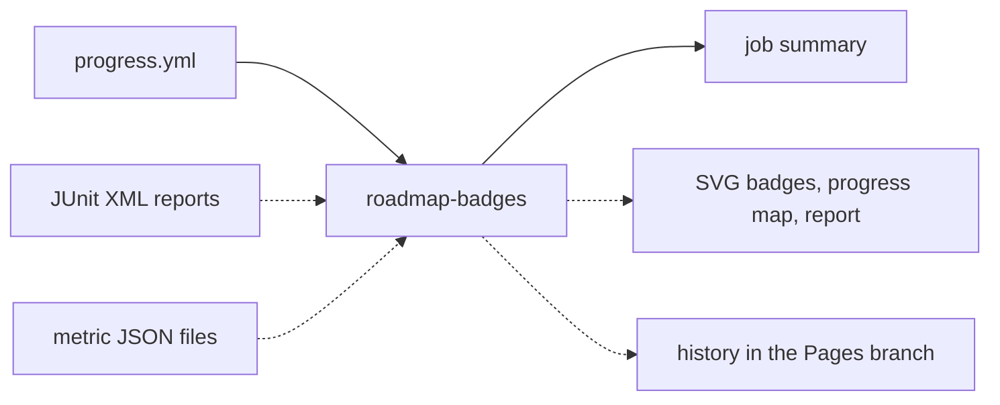

# Roadmap Badges

A GitHub Action that **computes** how far a project has got, from a catalog of what it sets out to
do and the results of its own tests, and publishes the result as badges, a progress map and a
history.

[](https://github.com/zxxdev/roadmap-badges/actions/workflows/ci.yml)
[](LICENSE)

> **Status: early development.** Today the action reads and checks the catalog, and reports
> every problem with its line and field. Reading the test reports and drawing the badges come in
> the next versions (see [Roadmap](#limitations-and-roadmap)). Images of the badges and the report
> will be added when the action draws them.

## Contents

- [Why it exists](#why-it-exists)
- [What it will do](#what-it-will-do)
- [How it differs from existing actions](#how-it-differs-from-existing-actions)
- [Usage](#usage)
- [The catalog: progress.yml](#the-catalog-progressyml)
- [How it works](#how-it-works)
- [Decisions](#decisions)
- [Quality](#quality)
- [Development](#development)
- [Security](#security)
- [Limitations and roadmap](#limitations-and-roadmap)
- [License](#license)

## Why it exists

A README that says "80% done" usually means someone typed 80. This action makes the number
checkable: the project lists what it sets out to do in a `progress.yml` file, each item is linked
to the tests that prove it, and the percentage is what CI can actually verify. Missing or skipped
tests count as not done, dropped items stay visible with their reason, and the history shows when
the list grew.

## What it will do

- Read `progress.yml`: the items a project sets out to do, grouped in areas.
- Decide each item from evidence: **JUnit XML** test reports (written by Vitest, Pester, pytest,
  Playwright, Maven and most other tools), **metric JSON** files with a target, or a **manual**
  `done` flag, used as little as possible.
- Publish **SVG badges** per area and overall, a **progress map** and an HTML report that links each
  item to its tests.
- Keep a **history** in the Pages branch, so the progress over time is visible.

## How it differs from existing actions

Before writing it, these were the closest existing actions (checked in November 2026):

| Action                                                                                                                                                                                                                                                  | What it does                                                                       | Difference                                                              |
| ------------------------------------------------------------------------------------------------------------------------------------------------------------------------------------------------------------------------------------------------------- | ---------------------------------------------------------------------------------- | ----------------------------------------------------------------------- |
| [gaelgirodon/ci-badges-action](https://github.com/gaelgirodon/ci-badges-action)                                                                                                                                                                         | Badges for test counts and coverage from JUnit, Cobertura, JaCoCo and LCOV reports | Counts tests; no catalog of features, no progress percentage or history |
| [markpatterson27/points-bar](https://github.com/markpatterson27/points-bar)                                                                                                                                                                             | Draws an SVG points bar from a value like `25/50`                                  | Draws a number you give it; does not compute it                         |
| [mikepenz/action-junit-report](https://github.com/mikepenz/action-junit-report), [dorny/test-reporter](https://github.com/dorny/test-reporter), [EnricoMi/publish-unit-test-result-action](https://github.com/EnricoMi/publish-unit-test-result-action) | Turn test reports into check runs, annotations and summaries                       | Report test results; they do not map tests to features                  |
| [shields.io](https://shields.io/) dynamic badges                                                                                                                                                                                                        | Draw a badge from a value in a JSON file or endpoint                               | Draw any number; something else has to compute it                       |

None of them turns a declared list of features plus test evidence into a progress figure. That
calculation, and keeping it honest, is what this action adds.

## Usage

The action is not released yet. To try the current version from a workflow:

```yaml
- uses: actions/checkout@v7
- uses: zxxdev/roadmap-badges@main # use a tag once one is released
  id: progress
  with:
    catalog: progress.yml # the default
- run: echo "${{ steps.progress.outputs.items }} items in ${{ steps.progress.outputs.areas }} areas"
```

| Input     | Default        | Description                                                                                     |
| --------- | -------------- | ----------------------------------------------------------------------------------------------- |
| `catalog` | `progress.yml` | Path to the catalog, relative to the repository root. The step fails if it is missing or wrong. |

| Output    | Description                                                          |
| --------- | -------------------------------------------------------------------- |
| `areas`   | Number of areas in the catalog.                                      |
| `items`   | Number of items that count towards the total (dropped items do not). |
| `dropped` | Number of dropped items.                                             |

The action writes a line to the log and a table of areas to the job summary.

## The catalog: progress.yml

The catalog lists what the project sets out to do, in areas. Each item says how it is proved:

```yaml
# yaml-language-server: $schema=https://raw.githubusercontent.com/zxxdev/roadmap-badges/main/schema/progress.schema.json
project: my-service
areas:
  - id: api
    title: API
    items:
      - id: api.get-user
        title: Get a user by id
        evidence: junit # done when the tests tagged @api.get-user pass
      - id: api.export
        title: Export users to CSV
        evidence: junit
        tests: # for tests that cannot carry the tag in their name
          - name: exports every user
            classname: tests/export.test.ts
        dropped: Replaced by the reports area # leaves the total, stays visible
  - id: docs
    title: Documentation
    items:
      - id: docs.runbook
        title: Runbook reviewed by the on-call team
        evidence: manual # only for what no test can check
        done: false
```

| Field                      | Rule                                                                                                               |
| -------------------------- | ------------------------------------------------------------------------------------------------------------------ |
| `project`                  | The project's name. Required.                                                                                      |
| `areas[].id`, `items[].id` | Lowercase letters and digits joined by `.` or `-`. Area ids are unique; item ids are unique across the whole file. |
| `title`                    | Required, not empty.                                                                                               |
| `evidence`                 | `junit` (proved by tests) or `manual` (decided by `done`). Required: there is no default.                          |
| `tests`                    | Optional, `junit` items only: tests chosen by `name` and, if needed, `classname`.                                  |
| `done`                     | Required for `manual` items, and only for them: `true` or `false`.                                                 |
| `dropped`                  | Optional: why the item was dropped. It leaves the total but stays in the file and the report.                      |

Unknown fields are errors, so a misspelt field cannot be ignored silently. When the catalog is
not valid, the step fails and lists every problem at once, with its line, column and field. In a
pull request each one shows as an annotation on that line:

```text
Error: tests/fixtures/catalogs/invalid.yml:10:19 areas[0].items[0].evidence: must be "junit" or "manual", not "junti"
Error: tests/fixtures/catalogs/invalid.yml:11:13 areas[0].items[1].id: must be lowercase letters and digits, joined by single "." or "-" (for example "api.get-user")
Error: tests/fixtures/catalogs/invalid.yml:14:9 areas[0].items[2].title: missing required field
Error: tests/fixtures/catalogs/invalid.yml:16:15 areas[0].items[2].done: must be true or false, not "yes"
Error: roadmap-badges: the catalog at tests/fixtures/catalogs/invalid.yml has 4 problems.
```

That is the output for [tests/fixtures/catalogs/invalid.yml](tests/fixtures/catalogs/invalid.yml),
an example CI runs the action on in every change. The file is read as YAML 1.2, so `yes` is text,
not `true`.

**Editor support.** [`schema/progress.schema.json`](schema/progress.schema.json) is a JSON Schema
generated from the same rules the action applies. With the first line of the example above, VS
Code (with the YAML extension) and JetBrains IDEs autocomplete fields and flag mistakes while you
type. The action still has the last word: the JSON Schema cannot check that ids are unique.

This repository measures itself with its own [progress.yml](progress.yml).

## How it works



Solid lines exist today; dotted ones are planned. The code is in three parts:

- `src/catalog/`: the catalog's rules, written once with [zod](https://zod.dev/)
  (`schema.ts`), and the reader (`parse.ts`), which parses the YAML with
  [`yaml`](https://eemeli.org/yaml/). zod says which field is wrong; the YAML document, which
  keeps each node's position, says on which line and column.
- `src/main.ts`: the steps of a run, which talk to the runner only through a small `Runner`
  interface, so tests pass a fake one.
- `src/index.ts`: connects that interface to the real runner with
  [`@actions/core`](https://github.com/actions/toolkit/tree/main/packages/core).

Rollup bundles them, with their dependencies, into `dist/index.js`, which is what GitHub runs.

## Decisions

- [0001](docs/adr/0001-bundle-the-action-with-rollup.md): TypeScript 6.0 bundled by Rollup into a
  committed `dist/index.js`, on Node 24, with CI checking that the bundle matches the source.
- [0002](docs/adr/0002-validate-the-catalog-with-zod-and-yaml.md): the catalog's rules in zod,
  positions from `yaml`, a generated JSON Schema; explicit evidence, unique ids, unknown fields
  are errors, and a missing or invalid catalog fails the step.

## Quality

On every pull request and push to `main`, CI:

- checks formatting (Prettier), lints with type-aware rules (typescript-eslint) and type checks;
- runs the unit tests (Vitest), including one that fails if `schema/progress.schema.json` no
  longer matches the rules in the source;
- rebuilds `dist/index.js` and fails if it differs from the committed one;
- runs the action itself from the checkout on this repository's catalog and on a valid example,
  and checks that an invalid example and a missing file fail;
- audits dependencies, and CodeQL analyses the source and the workflows.

The only badge above is CI, because it is the only one that exists. A progress badge for this
repository will come from the action itself once it can draw one.

## Development

Requirements: Node.js 24 or later and pnpm 12.

```sh
pnpm install --frozen-lockfile
pnpm all      # format check, lint, type check, tests and bundle
```

```text
action.yml                    inputs, outputs and the file GitHub runs
progress.yml                  this repository's own catalog
src/catalog/                  catalog rules (zod) and reader (yaml)
src/main.ts, src/index.ts     the run, and its connection to the runner
tests/                        Vitest tests; tests/fixtures/ has example catalogs
schema/progress.schema.json   generated JSON Schema (committed, do not edit)
dist/index.js                 generated bundle (committed, do not edit)
docs/adr/                     decision records
```

After changing `src/catalog/schema.ts`, run `pnpm test -u` to regenerate the JSON Schema.

More in [CONTRIBUTING.md](CONTRIBUTING.md).

## Security

The action runs inside other people's workflows, so it asks for no permissions of its own and has
three runtime dependencies: `@actions/core`, `zod` and `yaml`, the last two with no dependencies
of their own. Dependencies wait 7 days after release before pnpm installs them, install scripts
are blocked, and third-party actions in this repository's workflows are pinned by commit SHA.

The catalog is read as data only: YAML tags cannot run code, repeated keys are rejected, and alias
expansion is capped so a small file cannot blow up in memory. Text from the catalog is escaped
before it goes into the job summary. To report a vulnerability, see [SECURITY.md](SECURITY.md).

## Limitations and roadmap

Today it reads and checks the catalog; it does not compute any percentage yet. Planned, in order:

1. ~~The catalog: schema for `progress.yml`, clear errors with line and field, a JSON Schema for
   editors.~~ Done.
2. Evidence: JUnit XML reports and the link between items and tests.
3. Badges: SVG with accessible text.
4. Progress map and HTML report.
5. History in the Pages branch.
6. Version 1.0: metric files, a catalog built from an OpenAPI specification, more examples and
   the Marketplace listing.

## License

[MIT](LICENSE)
